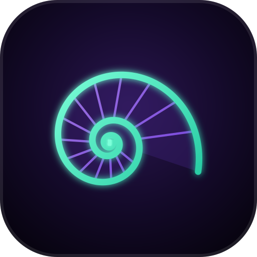

# Shellomancy



A fork of the open-source [Warp](https://github.com/warpdotdev/warp) terminal for the **madness_interactive** workshop. It keeps Warp's terminal (blocks, tabs, panes, themes, launch and tab configs, the command palette), runs offline, drops Warp's Oz agent platform, and adds a scriptable control CLI so hooks can open tabs that run commands.

> **Early build — not yet run.** As of this writing Shellomancy has only been type-checked and unit-tested (`cargo check`, `cargo test`); it has not been bundled or launched, because the build machine was still waiting on Xcode. Anything below marked *not verified* has no runtime evidence yet. macOS on Apple Silicon is the only target.

## Getting it

There are no releases. Build from source on macOS (Apple Silicon):

```sh
git clone https://github.com/MadnessEngineering/shellomancy.git
cd shellomancy
./script/run            # builds a debug Shellomancy.app and launches it
```

You need full Xcode with its Metal toolchain, Rust 1.92 (pinned by `rust-toolchain.toml`), and `cargo-bundle` 0.11. See [docs/building.md](docs/building.md); you do **not** need Warp's `./script/bootstrap`.

It is set up to run beside a stock Warp install without sharing state: its own bundle id (`cc.madnessinteractive.shellomancy`), its own settings under `~/.mad/shellomancy`, its own Keychain items and URL scheme (`shellomancy://`). That is checked by code and path tests, not yet by running both side by side.

## Keeping it updated

Shellomancy has no auto-updater (it is offline). Pull and rebuild:

```sh
git pull
./script/run
```

How the fork tracks upstream Warp is in [docs/upstream-sync.md](docs/upstream-sync.md).

## What makes it different?

Everything is listed, with the commit that implements it, in [docs/differences-from-warp.md](docs/differences-from-warp.md). The short version:

- **Offline by default** — no Warp login, no calls to Warp's servers, no telemetry or crash reports, no auto-update. The local install-detection server Warp's website talks to is not started. [Details](docs/privacy-and-offline.md).
- **A terminal, not an agent platform** — Warp's Oz cloud-agent features (cloud mode, ambient and scheduled agents, agent management, Oz platform and handoff) are switched off, and Settings hides pages that only manage Warp accounts. Claude Code, Codex and other CLI agents running inside the terminal keep Warp's integrations.
- **[`shellomancy` control CLI](docs/shellomancy-cli.md)** — Warp's local-control CLI (`warpctrl`), on by default and extended so a script can open a tab that runs a command:

  ```sh
  shellomancy tab create --command "claude attach 1f8b2155" --title agent --color cyan
  ```

  A stdlib Python client in [`script/shellomancy_client`](script/shellomancy_client/shellomancy_client.py) does the same from hooks without starting the app binary.
- **`~/.mad`** — settings live in `~/.mad/shellomancy`, and the control API's discovery records in `~/.mad/local-control`, a dot-dir shared with other workshop tools.
- **The nautilus** — new app icon, Dock-icon variants (Abyss, Bone, Ember, Mono, Toxic), loading animation and in-app marks, all generated from one SVG by [`script/shellomancy_brand`](script/shellomancy_brand/README.md).

## Status

What works, what doesn't, and what hasn't been tried: [docs/known-issues.md](docs/known-issues.md).

## Licensing

Shellomancy is a modified version of Warp. Warp's UI framework (the `warpui_core` and `warpui` crates) is licensed under the [MIT license](LICENSE-MIT); the rest of the code is licensed under the [AGPL v3](LICENSE-AGPL). Copyright for Warp's code remains with Denver Technologies, Inc.; Shellomancy's changes are released under the same licenses. The app's About page links to this source repository.

"Warp" is Warp's name. Shellomancy is not affiliated with or endorsed by Warp.

A few of Warp's git dependencies do not declare a license yet (see `about.toml`), so redistributing a built Shellomancy binary is an open question; building it yourself from this source is not affected. See [docs/known-issues.md](docs/known-issues.md).

## Contributing

This is a personal workshop fork; see [CONTRIBUTING.md](CONTRIBUTING.md). Engineering notes for the codebase itself are in [AGENTS.md](AGENTS.md) (upstream Warp's guide, still accurate for the code).
